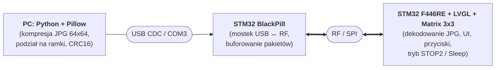

# RF Media Controller & Telemetry Handheld

Custom wireless handheld controller designed for remote media management and real-time track telemetry. Built from scratch around the **STM32** ecosystem, featuring a custom binary communication protocol, power-saving sleep states, and an OLED user interface.

> **Companion Host Application:** The PC-side bridge (Flask + Socket.IO + PySerial) responsible for browser integration, image dithering, and UART framing is maintained in: **[/bridge]**.

---

## System Architecture

## Binary Frame Specification

### 1. Quick Sync Frame (`0x01` – 7 Bytes)

| Byte Offset | Field | Type | Description |
| :--- | :--- | :--- | :--- |
| `0` | `SOF` | `uint8_t` | Start of Frame (`0xAA`) |
| `1` | `CMD` | `uint8_t` | Frame Type (`0x01`) |
| `2..3` | `CURRENT_SEC` | `uint16_t` | Current playback timestamp (Little Endian) |
| `4` | `IS_PLAYING` | `uint8_t` | Playback state (`1` = Playing, `0` = Paused) |
| `5` | `CHECKSUM` | `uint8_t` | Bitwise XOR of bytes `0..4` |
| `6` | `EOF` | `uint8_t` | End of Frame (`0x55`) |

### 2. Full Metadata & Cover Frame (`0x02` – 272 Bytes)

| Byte Offset | Field | Type | Description |
| :--- | :--- | :--- | :--- |
| `0` | `SOF` | `uint8_t` | Start of Frame (`0xAA`) |
| `1` | `CMD` | `uint8_t` | Frame Type (`0x02`) |
| `2..3` | `DURATION_SEC` | `uint16_t` | Total track duration in seconds |
| `4..5` | `CURRENT_SEC` | `uint16_t` | Current playback timestamp |
| `6` | `IS_PLAYING` | `uint8_t` | Playback state |
| `7..38` | `TITLE` | `char[32]` | Null-padded track title string |
| `39..70` | `ARTIST` | `char[32]` | Null-padded artist name string |
| `71..270` | `COVER_BMP` | `uint8_t[200]` | 40x40 1-bit monochrome bitmap |
| `271` | `CHECKSUM` | `uint8_t` | Bitwise XOR of bytes `0..270` |
| `272` | `EOF` | `uint8_t` | End of Frame (`0x55`) |

---
## How It Works
* **PC Host Bridge:** A Python script grabs current track details from your browser, compresses the album cover into a lightweight 64x64 image, and packs everything into small frames protected by CRC16.
* **USB-to-RF Dongle (BlackPill):** Acts as a wireless bridge, forwarding track data from the PC to the handheld and passing button presses back.
* **Handheld Remote (STM32F446RE):** Runs an LVGL-based interface to display the UI, scans the 3x3 mechanical switch matrix, and automatically enters deep sleep (STOP2) when idle to save battery.
* **Smart Syncing:** Full track details and cover art are sent only when a song changes or the remote wakes up. During playback, a tiny sync packet updates the timer once per second.

---

## Hardware Pinout (STM32F446RE Prototype)
* `USART2 (PA2/PA3)`: Host PC Virtual COM Port (`115200 bps`)
* `GPIO_Input (Pull-Up)`: 9-key tactile switch array (`PA0-WKUP`, `PA1`, `PA4`, `PB0`, `PB1`, `PC0..PC3`)
* `I2C1 (PB8/PB9)`: *Planned* – SSD1306 OLED Display
* `SPI1 (PA5/PA6/PA7)`: *Planned* – RF Transceiver Module

---

## Development Roadmap
- [x] 9-button input polling with software debouncing
- [x] Bidirectional UART bridge with Python Host Server
- [x] Binary protocol specification (`SYNC` & `FULL` frames + XOR validation)
- [ ] Hardware EXTI interrupts & low-power Sleep/Wake-up state machine
- [ ] SSD1306 OLED UI rendering (bitmap cover + progress bar)
- [ ] FreeRTOS task migration
- [ ] Custom PCB layout (Altium Designer) & 3D printed enclosure